  <!-- ========================================== -->
  <!-- 01. ANIMATED HERO BANNER                   -->
  <!-- ========================================== -->
  

   

  <!-- Direct Communication & Social Links -->
  
  &nbsp;
  
  &nbsp;
  

    

  <!-- Navigation Anchors -->
  <b>
    <a href="#-professional-summary">Summary</a> &nbsp;•&nbsp;
    <a href="#%EF%B8%8F-verified-technical-skills">Skills</a> &nbsp;•&nbsp;
    <a href="#-work-experience">Experience</a> &nbsp;•&nbsp;
    <a href="#-featured-projects">Projects</a> &nbsp;•&nbsp;
    <a href="#-academic-education">Education</a> &nbsp;•&nbsp;
    <a href="#-github-activity--contribution-graph">Activity</a> &nbsp;•&nbsp;
    <a href="#-connect--collaborate">Connect</a>
  </b>

 

  

## 📌 Professional Summary

  

 

  

## 🛠️ Verified Technical Skills

  

 

  

## 💼 Work Experience

  

 

  

## 🚀 Featured Projects

  

 

<b>🔍 Expand for Live Project Deployments &amp; Repositories</b>

 

<table>
  <thead>
    <tr>
      <th width="32%">Project &amp; Live URL</th>
      <th width="48%">Key Architectural Accomplishments</th>
      <th width="20%">Stack</th>
    </tr>
  </thead>
  <tbody>
    <tr>
      <td>
        <b>PayFlow</b> 
        Money Transfer Management  
        🌐 <a href="https://payflow.khodaltech.in"><b>payflow.khodaltech.in</b></a> 
        <i>March 2026 – May 2026</i>
      </td>
      <td>
        • Developed secure money transfer platform managing customers, bank accounts, cash denominations, transactions, reports, and multi-company operations. 
        • Built secure JWT &amp; refresh token authentication, RESTful APIs, and scalable backend workflows. 
        • Created responsive interfaces with Next.js, React.js, TypeScript, Tailwind CSS, ShadCN UI, and hybrid caching.
      </td>
      <td>
        <code>Next.js</code> 
        <code>React.js</code> 
        <code>TypeScript</code> 
        <code>Tailwind CSS</code> 
        <code>ShadCN UI</code> 
        <code>Node.js</code> 
        <code>Express.js</code> 
        <code>MongoDB</code>
      </td>
    </tr>
    <tr>
      <td>
        <b>Dentcare360</b> 
        Dental Clinic Management  
        🌐 <a href="https://dentcare360.in"><b>dentcare360.in</b></a> 
        <i>July 2026 – Present</i>
      </td>
      <td>
        • Developed role-based clinic platform managing patients, appointments, consultations, treatment plans, invoices, billing, and clinic operations. 
        • Implemented granular Role-Based Access Control (RBAC) across clinic staff. 
        • Built responsive clinical dashboards and reusable components with Next.js, React.js, Tailwind CSS, and ShadCN UI.
      </td>
      <td>
        <code>Next.js</code> 
        <code>React.js</code> 
        <code>TypeScript</code> 
        <code>Tailwind CSS</code> 
        <code>ShadCN UI</code> 
        <code>Node.js</code> 
        <code>Express.js</code> 
        <code>MongoDB</code>
      </td>
    </tr>
    <tr>
      <td>
        <b>SmartCalc</b> 
        Financial Calculator App  
        📱 <i>Google Play Store</i> 
        <i>June 2026</i>
      </td>
      <td>
        • Developed Flutter calculator providing EMI, SIP, GST, Loan, and Discount calculators with offline support. 
        • Integrated Firebase Cloud Firestore, Analytics, and Crashlytics monitoring. 
        • Integrated Google AdMob monetization with an uncluttered Material interface.
      </td>
      <td>
        <code>Flutter</code> 
        <code>Dart</code> 
        <code>Firebase</code> 
        <code>Firestore</code> 
        <code>Provider</code> 
        <code>Riverpod</code> 
        <code>AdMob</code>
      </td>
    </tr>
    <tr>
      <td>
        <b>Flipix</b> 
        Multiplayer Memory Game  
        📱 <i>Google Play Store</i> 
        <i>June 2026 – July 2026</i>
      </td>
      <td>
        • Developed real-time multiplayer memory card matching game with Google Sign-In, guest login, scores, achievements, and animations. 
        • Integrated Firebase Cloud Firestore for real-time game data with Provider &amp; Riverpod state management. 
        • Integrated Google AdMob monetization and responsive 60fps Flutter UI.
      </td>
      <td>
        <code>Flutter</code> 
        <code>Dart</code> 
        <code>Firebase</code> 
        <code>Firestore</code> 
        <code>Google Sign-In</code> 
        <code>Provider</code> 
        <code>Riverpod</code>
      </td>
    </tr>
    <tr>
      <td>
        <b>Explore Animal Sounds</b> 
        Educational Mobile App  
        📱 <i>Google Play Store</i> 
        <i>August 2026 – Present</i>
      </td>
      <td>
        • Developed educational app for toddlers to explore real animal sounds, HD visuals, and multi-language pronunciations. 
        • Integrated Firestore backend for dynamic category management. 
        • Implemented native audio playback, multilingual content, and AdMob monetization with a child-friendly interface.
      </td>
      <td>
        <code>Flutter</code> 
        <code>Dart</code> 
        <code>Firebase</code> 
        <code>Firestore</code> 
        <code>Audio Player</code> 
        <code>Multi-Language</code> 
        <code>AdMob</code>
      </td>
    </tr>
  </tbody>
</table>

 

  

## 🎓 Academic Education

  

 

  

## 📊 GitHub Activity & Contribution Graph

  
   
  <i>Verified GitHub contribution activity for <a href="https://github.com/Parthvaghle123">@Parthvaghle123</a> tinted in signature burgundy (<code>#451126</code>).</i>

 

  
  &nbsp;
  

 

  

## 📬 Connect & Collaborate

- 💼 **LinkedIn Profile**: [linkedin.com/in/parth1407](https://linkedin.com/in/parth1407)
- 🐙 **GitHub Profile**: [github.com/Parthvaghle123](https://github.com/Parthvaghle123)
- ✉️ **Direct Email**: [vaghelaparth2005@gmail.com](mailto:vaghelaparth2005@gmail.com)
- 🌐 **Production Web Apps**: [payflow.khodaltech.in](https://payflow.khodaltech.in) &nbsp;•&nbsp; [dentcare360.in](https://dentcare360.in)

 

  <!-- Minimal Animated Burgundy Footer -->
  

